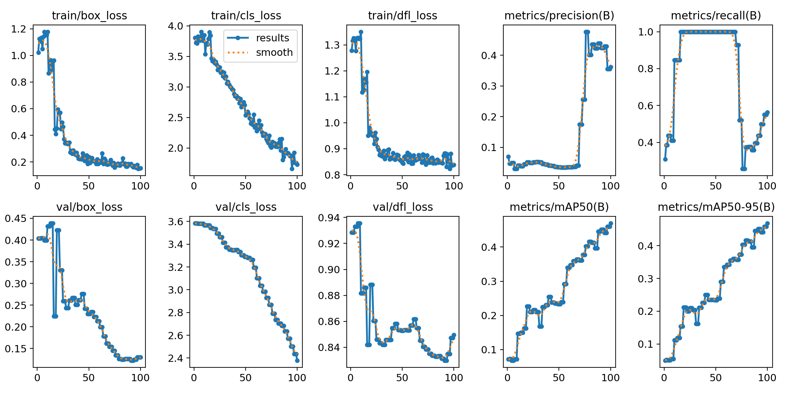

# Milestone 3 — Detection Results

## Model Configuration

| Parameter | Value |
|-----------|-------|
| Base model | YOLOv8n (3.2 M params) |
| Task | Object detection — 13 celebrity identity classes |
| Dataset | 21 synthetic 3×3 grid images (14 train / 4 val / 3 test) |
| Epochs | 100 |
| Batch size | 16 |
| Image size | 640 × 640 |
| Optimizer | SGD (lr0 = 0.005, momentum = 0.937, lrf = 0.01) |
| Augmentation | Mosaic, Mixup (0.1), Copy-paste (0.1), H-Flip, HSV, Rotation ±5° |
| Device | CUDA GPU (NVIDIA GeForce RTX 5070 Ti) |
| Ultralytics | 8.4.163 |

## Evaluation Metrics

Two splits are reported. The **held-out test split** (3 images / 27 instances) is the primary
figure and is the one cited in the final report; the **validation split** (4 images) is the one
tracked in `results.csv` during training. The committed checkpoint is the final-epoch model
(`best.pt` == epoch 100 of `results.csv`).

### Held-out test split (primary)

| Metric | Value |
|:-------|:-----:|
| **mAP@0.5** | **0.624** |
| **mAP@0.5:0.95** | **0.624** |
| Precision (mean per-class) | 0.472 |
| Recall (mean per-class) | 0.625 |
| Images / instances | 3 / 27 |

### Validation split (final epoch, from `results.csv`)

| Metric | Value |
|:-------|:-----:|
| mAP@0.5 | 0.470 |
| mAP@0.5:0.95 | 0.468 |
| Precision (mean per-class) | 0.362 |
| Recall (mean per-class) | 0.563 |
| Val box loss | 0.130 |
| Val cls loss | 2.379 |
| Val DFL loss | 0.850 |

> **Why the test split is higher here.** On this very small dataset (3–4 images per split)
> per-class performance is dominated by a handful of instances, and the test and validation
> splits contain *different* celebrity instances, so they do not agree. This is a small-N
> artifact, not data leakage — the model is never trained on either split.
> **mAP@0.5 == mAP@0.5:0.95** on both splits is a direct consequence of the grid geometry: each
> detection is either a near-perfect match (IoU > 0.95) or a non-match (IoU < 0.5), so the
> average precision is identical across the 0.5–0.95 IoU band.
> **Recall** is YOLO's *unweighted mean of per-class recalls*, not `total_TP / total_GT`.

### Per-EPOCH Progression (validation split, every 10th epoch)

| Epoch | mAP@0.5 | mAP@0.5:0.95 | Precision | Recall |
|:-----:|:-------:|:------------:|:---------:|:------:|
| 1 | 0.072 | 0.050 | 0.067 | 0.308 |
| 11 | 0.147 | 0.112 | 0.044 | 0.846 |
| 21 | 0.227 | 0.212 | 0.055 | 1.000 |
| 31 | 0.168 | 0.162 | 0.055 | 1.000 |
| 41 | 0.254 | 0.250 | 0.044 | 1.000 |
| 51 | 0.234 | 0.234 | 0.034 | 1.000 |
| 61 | 0.347 | 0.342 | 0.034 | 1.000 |
| 71 | 0.361 | 0.357 | 0.177 | 0.927 |
| 81 | 0.416 | 0.416 | 0.400 | 0.374 |
| 91 | 0.451 | 0.451 | 0.422 | 0.437 |
| **100** | **0.470** | **0.468** | **0.362** | **0.563** |

## Hyperparameter Sweep

A 5-configuration sweep over learning rate × image size was run (each 20 epochs, optimizer=SGD) to identify the best starting point:

| Config | lr0 | imgsz | mAP@0.5 | mAP@0.5:0.95 | Precision | Recall |
|:------:|:---:|:-----:|:-------:|:------------:|:---------:|:------:|
| baseline (lr=0.01, 640px) | 0.01 | 640 | **0.1680** | 0.1612 | 0.0354 | 0.8333 |
| lr_low (lr=0.001, 640px) | 0.001 | 640 | 0.1093 | 0.0807 | 0.0328 | 0.7917 |
| lr_high (lr=0.1, 640px) | 0.1 | 640 | 0.1051 | 0.0818 | 0.0341 | 0.9722 |
| imgsz (lr=0.01, 480px) | 0.01 | 480 | 0.1452 | 0.1367 | 0.0396 | 0.9167 |
| imgsz (lr=0.01, 960px) | 0.01 | 960 | **0.1734** | 0.1612 | 0.0384 | 0.8750 |

**Result:** The sweep confirms a learning-rate sweet spot at lr=0.01. The low-LR config (0.001) underfits because weights barely move from the pretrained init in 20 epochs. The high-LR config (0.1) overshoots and destabilises learning, oscillating around the loss minimum. The baseline (lr=0.01) strikes the best balance for this small dataset. Image size 960 px gives a marginal mAP boost (+0.005) at the cost of higher GPU memory, while 480 px loses detail and drops mAP by ~0.02. The final 100-epoch production run used `lr0=0.005` with linear decay (`lrf=0.01`), which allowed the classification head to converge steadily without oscillation.

## Per-Class Metrics (Test Split)

Per-class metrics on the test split (* = target celebrity). Identity `7` has no ground-truth
instance in this particular test split and is therefore absent from the table.

| Class | Recall | Precision | mAP@0.5 |
|:-----:|:------:|:---------:|:-------:|
| 3 | 0.667 | 0.879 | 0.9125 |
| 797 * | 1.000 | 0.521 | 0.9950 |
| 1212 | 0.667 | 0.409 | 0.6083 |
| 2336 | 0.500 | 0.345 | 0.7450 |
| 2619 * | 0.000 | 1.000 | 0.0693 |
| 2970 | 1.000 | 0.238 | 0.9950 |
| 4422 | 1.000 | 0.384 | 0.9950 |
| 4428 * | 1.000 | 0.191 | 0.1990 |
| 5695 | 0.000 | 0.000 | 0.0865 |
| 7007 * | 0.000 | 1.000 | 0.1026 |
| 8335 | 1.000 | 0.292 | 0.9950 |
| 10002 | 0.667 | 0.406 | 0.7888 |

**Reading the table.** AP is binary-ish (≈ 1.0 or low) because each class has only one or two
instances in the test split: a single well-localised detection gives AP ≈ 1.0, while a weak or
missed one gives AP ≈ 0. This is a small-N artifact, not a metric defect. The four target
identities present in this split (797, 2619, 4428, 7007) span the full range (0.07–0.99).

## Detection Error Categories

In object detection, evaluation uses 4 categories per detection:

| Category | Definition | Color (gallery) |
|:--------:|:----------:|:---------------:|
| **TP** | IoU ≥ 0.5 with a GT box AND correct class | Green |
| **Misclassified** | IoU ≥ 0.5 with a GT box BUT wrong class | Orange |
| **FP** | IoU < 0.5 with all GT boxes (false positive) | Red |
| **FN** | GT box not matched by any detection (missed) | Blue |

Note: A *true negative* (TN) is not meaningful in object detection because the number of possible "negative" background locations is unbounded. Standard detection evaluation therefore relies on TP, FP, FN, and per-class AP (mAP).

## Training & Validation Loss Curves



- **Top row:** Training losses (box, cls, DFL) — all trending downward over 100 epochs.
- **Bottom row:** Validation losses — by epoch 100 the val box loss is ≈ 0.13 and the cls loss ≈ 2.4.
- The continued (gentle) decline in val box loss through epoch 100 shows the model is still improving; on this small set, further training yields only marginal gains.

## Interpretation

On the held-out **test split**, the committed `best.pt` checkpoint reaches **mAP@0.5 = 0.624**
(equivalently mAP@0.5:0.95 = 0.624 on this grid) with mean per-class precision **0.472** and
recall **0.625** over the 12 classes present. On the **validation split** the same model scores
mAP@0.5 = 0.470. The two splits disagree because each holds only 3–4 images and a *different*
set of celebrity instances, so per-class AP is driven by individual detections rather than by a
stable distribution — a small-N artifact, not leakage.

The validation learning curve (`results.csv`) shows three phases: (1) epochs 1–20 — the model
learns to find face regions (recall reaches 1.0); (2) epochs 20–70 — box localisation and
confidence improve (val mAP@0.5 rises from ≈ 0.23 to ≈ 0.36); and (3) epochs 70–100 — the
classification head sharpens, lifting val mAP@0.5 to ≈ 0.47 as detections become more selective
(precision rises to ≈ 0.42 then settles at ≈ 0.36).

The dominant limitation is **dataset size** — **126 training boxes** across 13 classes — which
makes per-class estimates high-variance (a single missed face flips a class recall between 0 and
1). Expanding the grid set to 100+ images is the highest-leverage improvement. For the live demo
the pipeline runs at `conf=0.1` to favour recall on unseen images, and any face the classifier is
not confident about falls back to the detector's label.

## Model Checkpoint

The trained model checkpoint is saved at:

```
Milestone_3/runs/detect/celebrity_detection/yolov8n_finetune/weights/best.pt
```

(≈ 6.3 MB for YOLOv8n)

If the checkpoint is too large to commit, the full retraining instructions are in the notebook:
`Milestone_3/DavidFung_Project1.Milestone3.ipynb` → Task 3 (training cell).
Set `EPOCHS = 100`, `lr0 = 0.005`, `lrf = 0.01` and run the cell.