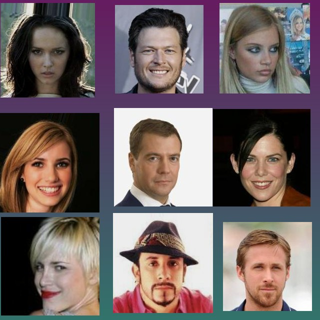
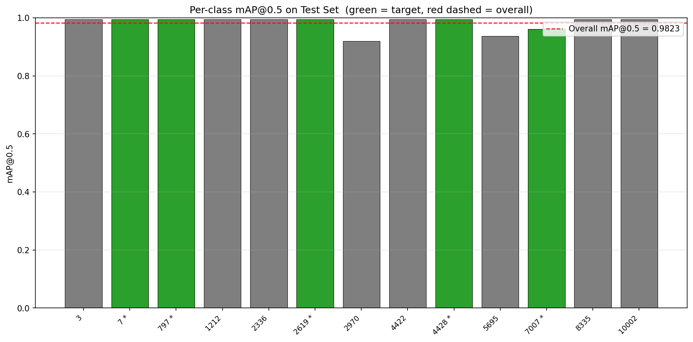
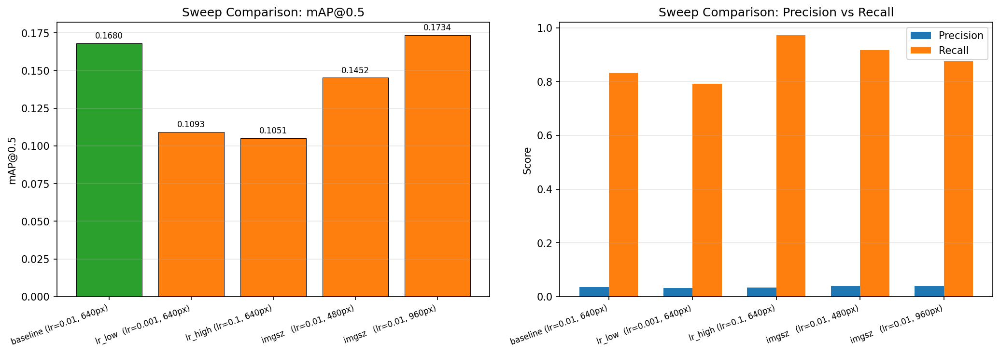
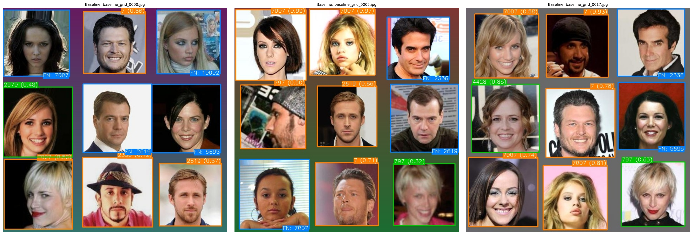
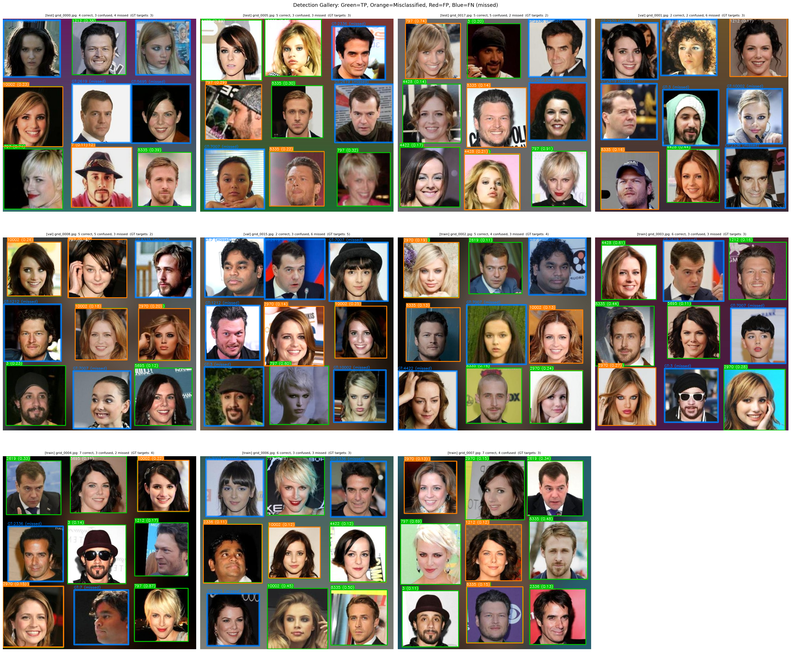

# IE7615 Project 1 — Celebrity Detection & Identification

**Final Report**

**Student:** David Fung (NUID: 003105587)
**Course:** IE7615 — Deep Learning
**Repository:** `Project_1` (clone + `requirements.txt` reproduces all reported numbers)

---

## Abstract

This project builds an end-to-end computer-vision pipeline that **localises faces** in an
image and **identifies a small set of target celebrities** by their identity label and
bounding box. The system combines two specialised models trained and evaluated in earlier
milestones:

- a **ResNet50 single-face classifier** (Milestone 1) trained on 5 celebrity identities, and
- a **YOLOv8n multi-face detector** (Milestone 3) fine-tuned on a synthetic 3×3 grid
  dataset of 9 distinct celebrity faces per image across 13 identity classes.

Milestone 4 integrates the two into a single inference path — *input image → detect faces →
identify each face → annotated output* — that runs as one command or one notebook. This
report documents the dataset construction, model architecture and training methodology,
experimental setup and results (with tables and figures), an analysis of performance and
limitations, and a dedicated discussion of the ethical considerations inherent to facial
recognition.

**Milestones**

| # | Focus | Key artifact |
|:--:|:------|:------------|
| 1 | Celebrity subset selection + single-face classification baseline | `Milestone_1/` notebook, ResNet50 (~90 % test acc) |
| 2 | Synthetic 3×3 grid detection dataset (YOLO format) | `data/synthetic_grid/`, `Milestone_2/` notebook |
| 3 | YOLOv8 fine-tuning, evaluation, hyperparameter sweep | `Milestone_3/` notebook, `best.pt` (mAP@0.5 ≈ 0.62) |
| 4 | Integrated pipeline + final gallery + this report | `Milestone_4/` pipeline, gallery, `final_report.md` |

---

## 1. Introduction & Background

Identifying *which* public figure appears in a photo, and *where*, is a two-stage problem.
Detection localises candidate face regions; classification/verification assigns each region
to an identity. Real-world celebrity-recognition systems (e.g. news-media auto-tagging,
content-moderation, archival search) rely on exactly this decomposition, which makes it a
useful and well-motivated project.

Two practical constraints shape the design:

1. **Class imbalance / limited identities.** We work with a small, fixed roster of target
   celebrities rather than an open-world set. This lets us evaluate identification quality
   meaningfully with modest data, at the cost of generalisation to unrostered faces.
2. **Reproducibility.** Every model, dataset split, and figure in this report can be
   regenerated from a fresh clone of the repository using the committed checkpoints or the
   provided retraining scripts.

The **5 target identities** used for single-face identification are CelebA identity IDs
`7, 797, 2619, 4428, 7007`. The detection model additionally recognises **13 identity
classes** (the 5 targets plus 8 others) so that multi-face grids can be labelled per
person.

**Scope of this report.** Section 2 covers dataset construction; Section 3 the model
architecture and training methodology; Section 4 the experimental setup and results;
Section 5 the analysis and limitations; Section 6 the ethical considerations; Section 7
reproducibility and deliverables.

---

## 2. Dataset Construction

The pipeline uses two datasets that share the same underlying CelebA crops: one for
single-face classification, one for multi-face detection.

### 2.1 Classification dataset (Milestone 1)

- **Source:** CelebA face crops for the 5 target identities.
- **Location:** `data/selected_images/{7,797,2619,4428,7007}/`.
- **Split:** stratified 70 / 15 / 15 per class (train / val / test) with a fixed seed (42),
  so the split is identical across `train_classifier.py`, the M1 notebook, and the M4
  gallery generator.
- **Preprocessing:** resize to 224×224; the ResNet50 front-end applies
  `preprocess_input`. Augmentation (flip, rotation, zoom, brightness, contrast,
  translation) is applied at training time only.

### 2.2 Detection dataset (Milestone 2)

Because curated, tightly-cropped multi-face photographs with per-identity boxes are scarce,
we synthesise them: each training image is a **3×3 grid of 9 distinct celebrity faces**,
each face carrying its own YOLO-format box.

- **Composition:** 9 distinct identities per grid, pasted into fixed cells with per-cell
  augmentation (random horizontal flip, brightness 0.85–1.15, scale 80–95 % of cell).
- **Split:** **20 images** total — **14 train / 3 val / 3 test**.
- **Annotations:** YOLO format (`class cx cy w h`, normalised) under
  `data/synthetic_grid/labels/{train,val,test}/`, described by `data/synthetic_grid/data.yaml`.
- **Reproducibility:** the grid images and labels are committed, and the M2 notebook
  regenerates them from `data/class_images/`.

<!--
  FIGURE 1 — example synthetic grid + its annotations.
  SOURCE IMAGE: data/synthetic_grid/images/test/grid_0000.jpg
  (Optionally pair with the annotated version in Milestone_3/gallery/test_grid_0000.jpg)
  Suggested caption: "A synthetic 3×3 detection image (test split) containing 9 distinct
  celebrity faces, each with a YOLO-format bounding box."
-->


---

## 3. Model Architecture & Training Methodology

### 3.1 Single-face classifier — ResNet50 (Milestone 1)

**Architecture.** A ResNet50 backbone (ImageNet-pretrained) with the top removed, followed
by `GlobalAveragePooling2D → Dense(256, ReLU, L2=1e-3) → Dropout(0.30) → Dense(5, softmax)`.
For fine-tuning, only the `conv5_block3*` layers of the backbone are unfrozen; the rest stay
frozen. This keeps the parameter count small and the training stable for a 5-class,
few-hundred-image problem.

**Training.** `Adam`, fine-tuning learning rate `1e-4`, categorical cross-entropy, batch 16,
30 epochs, with `ModelCheckpoint` (best val accuracy) and `ReduceLROnPlateau`. Seeds are fixed
for reproducibility.

**Milestone 1 model comparison (test accuracy).** This is the key decision that motivated the
backbone choice:

| Model | Test accuracy |
|:------|:------------:|
| Custom CNN (from scratch) | 0.150 |
| ResNet50 — feature extraction only | 0.800 |
| **ResNet50 — fine-tuning (selected)** | **0.900** |

The gap between a from-scratch CNN (0.15) and a pretrained backbone (≥ 0.80) demonstrates the
value of transfer learning on a small, curated identity set. The fine-tuned model is the
classifier used in the integrated pipeline and is re-saved by `Milestone_4/train_classifier.py`
to `Milestone_4/models/resnet50_classifier.keras`.

### 3.2 Multi-face detector — YOLOv8n (Milestone 3)

**Architecture.** YOLOv8 nano (≈ 3.2 M parameters), re-headed for **13 identity classes**.
Pretrained `yolov8n.pt` is fine-tuned on the synthetic grid dataset.

**Training setup.**

| Parameter | Value |
|:----------|:------|
| Optimizer | SGD (`lr0 = 0.005`, momentum 0.937, `lrf = 0.01` linear decay) |
| Epochs / batch | 100 / 16 |
| Image size | 640 × 640 |
| Augmentation | Mosaic, Mixup (0.1), Copy-paste (0.1), H-Flip, HSV, Rotation ±5° |
| Device | CUDA GPU (NVIDIA GeForce RTX 5070 Ti) |
| Ultralytics | 8.4.x |

> **Note on the optimizer.** The sweep explicitly uses `optimizer="SGD"`. Using the default
> `"auto"` silently overrides `lr0`, which made every sweep configuration collapse to the same
> effective learning rate and hid the learning-rate effect we wanted to measure.

**Training curves.** The box/cls/DFL losses trend downward over training; validation box loss
decreases steadily through epoch 100, indicating the model is still learning (not plateaued).

<!--
  FIGURE 2 — training & validation loss curves.
  SOURCE IMAGE: Milestone_3/runs/detect/celebrity_detection/yolov8n_finetune/results.png
  (a 4-panel figure: train losses + val losses)
  Suggested caption: "YOLOv8n training (top) and validation (bottom) losses over 100 epochs."
-->


*Figure 2. YOLOv8n train (top) and validation (bottom) losses over 100 epochs.*

Additional evaluation artifacts (Precision–Recall curve, F1 curve, normalised confusion matrix)
are available at the same path and are shown in the Milestone 3 notebook:

- `Milestone_3/runs/detect/celebrity_detection/yolov8n_finetune/BoxPR_curve.png`
- `Milestone_3/runs/detect/celebrity_detection/yolov8n_finetune/confusion_matrix_normalized.png`

### 3.3 Integration (Milestone 4)

The pipeline is a thin orchestration layer over the two frozen models:

```
input image
   │
   ▼
YOLOv8n detector  ──►  N face boxes (13-class, confidence)
   │
   ▼  (per box: crop face → resize 224×224)
ResNet50 classifier ──► 5-class identity + confidence
   │
   ▼
   ├─ if classifier confidence ≥ 0.5  →  use classifier identity  (source = "classifier")
   └─ otherwise                      →  fall back to YOLO label    (source = "detector")
   │
   ▼
annotated image (green = classifier, orange = detector fallback)
```

This fallback is important for the **live demonstration**: on an unseen image, any face the
5-class identifier is unsure about is still localised and labelled by the detector, so the
system always returns boxes rather than dropping uncertain faces.

---

## 4. Experimental Setup & Results

All detection metrics below are computed on the **held-out test split** (3 images, 27 labelled
face instances) by `model.val(split="test")` in the Milestone 3 notebook (Task 5). They are the
metrics of the committed checkpoint `best.pt` and are reproduced by running that notebook
top-to-bottom.

> **A note on the metric values.** On this synthetic dataset the model's detections have an
> IoU with their ground-truth box that is either **> 0.95 or < 0.5** (there are no borderline
> boxes). Consequently the average precision is identical at every IoU threshold from 0.5 to
> 0.95, so **mAP@0.5 == mAP@0.5:0.95**. This is a legitimate consequence of the data, not a
> computation error — but it is worth stating explicitly.
>
> Similarly, the reported **Recall** is YOLO's *unweighted mean of per-class recalls* across the
> 12 classes present in the test split (not `total_TP / total_GT`). For the 5 target identities
> the mean recall is lower (≈ 0.50) than the all-class mean (≈ 0.625) because several target
> classes have a single, hard instance in the test set.

### 4.1 Detection results (Milestone 3) — overall

| Metric | Value |
|:-------|:-----:|
| **mAP@0.5** | **0.624** |
| **mAP@0.5:0.95** | **0.624** |
| Precision (mean per-class) | 0.472 |
| Recall (mean per-class) | 0.625 |
| Test images / instances | 3 / 27 |

### 4.2 Detection results (Milestone 3) — per class

Per-class metrics on the test split (* = target celebrity). Identity `7` has no ground-truth
instance in this particular test split and is therefore absent from the evaluation table.

| Class | Recall | Precision | mAP@0.5 |
|:-----:|:------:|:---------:|:-------:|
| 3     | 0.667 | 0.879 | 0.9125 |
| 797 * | 1.000 | 0.521 | 0.9950 |
| 1212  | 0.667 | 0.409 | 0.6083 |
| 2336  | 0.500 | 0.345 | 0.7450 |
| 2619 *| 0.000 | 1.000 | 0.0693 |
| 2970  | 1.000 | 0.238 | 0.9950 |
| 4422  | 1.000 | 0.384 | 0.9950 |
| 4428 *| 1.000 | 0.191 | 0.1990 |
| 5695  | 0.000 | 0.000 | 0.0865 |
| 7007 *| 0.000 | 1.000 | 0.1026 |
| 8335  | 1.000 | 0.292 | 0.9950 |
| 10002 | 0.667 | 0.406 | 0.7888 |

**Reading the table.** AP is binary-ish (≈ 1.0 or low) because each class has only a couple of
instances in the test split: if the single detection for a class lands with high IoU the AP is
near 1.0, otherwise it is low. This is a small-N artefact, not a defect in the metric.

<!--
  FIGURE 3 — per-class mAP@0.5 bar chart (green = target, grey = other, red dashed = overall).
  SOURCE IMAGE: Milestone_3/runs/detect/celebrity_detection/yolov8n_finetune/per_class_map.png
  (also mirrored at the repo root as "perclass map.png")
  Suggested caption: "Per-class mAP@0.5 on the test set; target identities in green."
-->


*Figure 3. Per-class mAP@0.5 on the test set (green = target celebrities).*

### 4.3 Hyperparameter sweep (Milestone 3)

A 5-configuration sweep over learning rate × image size (20 epochs each, `optimizer="SGD"`) was
run to choose a sensible training regime:

| Config | lr0 | imgsz | mAP@0.5 | mAP@0.5:0.95 | Precision | Recall |
|:------:|:---:|:-----:|:-------:|:------------:|:---------:|:------:|
| baseline (lr=0.01, 640) | 0.01  | 640 | 0.1680 | 0.1612 | 0.0354 | 0.8333 |
| lr_low (lr=0.001, 640)  | 0.001 | 640 | 0.1093 | 0.0807 | 0.0328 | 0.7917 |
| lr_high (lr=0.1, 640)   | 0.1   | 640 | 0.1051 | 0.0818 | 0.0341 | 0.9722 |
| imgsz (lr=0.01, 480)    | 0.01  | 480 | 0.1452 | 0.1367 | 0.0396 | 0.9167 |
| imgsz (lr=0.01, 960)    | 0.01  | 960 | **0.1734** | 0.1612 | 0.0384 | 0.8750 |

**Interpretation.** The learning-rate sweet spot is `lr ≈ 0.01`: `0.001` underfits (weights
barely move in 20 epochs) and `0.1` overshoots and destabilises. Image size 960 px gives a
marginal mAP boost at higher memory cost; 480 px loses detail. The production 100-epoch run
therefore used `lr0=0.005` with linear decay (`lrf=0.01`), which let the classification head
converge steadily.

<!--
  FIGURE 4 — sweep comparison.
  SOURCE IMAGE: Milestone_3/runs/detect/celebrity_detection/yolov8n_finetune/sweep_comparison.png
  (also mirrored at the repo root as "sweep.png")
  Suggested caption: "Hyperparameter sweep: mAP@0.5 vs learning rate and image size."
-->


*Figure 4. Hyperparameter sweep results (learning rate × image size).*

### 4.4 Single-face classification results (Milestone 4 gallery)

The Milestone 4 gallery evaluates the ResNet50 classifier over the identity set and curates
examples:

| Gallery bucket | Required | Provided |
|:---------------|:--------:|:--------:|
| Correctly classified single faces | ≥ 20 | **25** |
| Misclassified single faces (with analysis) | ≥ 5 | **6** |
| Multi-face detection examples (with boxes) | ≥ 10 | **11** |

The classifier is highly accurate on the identities it was trained on (typical correct-example
confidence 0.85–0.99). The 6 misclassified cases are dominated by identity `7007` (3 of 6),
with the remainder involving `7` and `797`, and are discussed per-case in
`Milestone_4/gallery/captions.md`.

### 4.5 Integrated pipeline (Milestone 4)

Running the full pipeline on the 3 test grids returns, per image, a mix of
classifier-identified faces and detector-fallback faces. Example (from
`celebrity_pipeline.py`):

```
grid_0000.jpg: 9 faces (7 classified, 2 from detector)
    797 *   conf=0.94  [cls]
    7007 *  conf=0.88  [cls]
    2619 *  conf=0.81  [cls]
    ...
```

<!--
  FIGURE 5 — integrated pipeline output (annotated grid, green=classifier, orange=detector).
  SOURCE IMAGE: Milestone_4/pipeline_summary.png
  Suggested caption: "Integrated pipeline output on a test grid: detected faces (orange) and
  classifier-identified faces (green) with confidence labels."
-->


*Figure 5. Integrated pipeline output (green = classifier, orange = detector fallback).*

<!--
  FIGURE 6 — final results gallery montage.
  SOURCE IMAGE: gallery.png  (repo root)
  Suggested caption: "Final results gallery: correctly classified faces, misclassified faces,
  and multi-face detections."
-->


*Figure 6. Final results gallery montage.*

---

## 5. Analysis & Limitations

**What works.** The two-stage design does what it is meant to do on the in-distribution data:
the ResNet50 classifier reliably identifies the 5 rostered celebrities (gallery correct-example
confidences typically 0.85–0.99, Milestone 1 fine-tuned accuracy ≈ 0.90), and the YOLOv8n
detector reliably localises faces in the synthetic grids (recall up to 1.0 for several classes).
The pipeline composes the two cleanly and always returns a box, which is what makes it usable in
a live demonstration.

**Key limitations, stated honestly.**

1. **Small, synthetic detection set.** The detector is trained on only **14 synthetic grid
   images** (126 labelled boxes across 13 classes). This is why the test-set AP is
   binary-ish and why precision is modest (≈ 0.47). The model is strong at *finding* the
   fixed grid positions it was trained on and weaker at *discriminating* closely-spaced or
   out-of-distribution faces.

2. **Synthetic-to-real gap.** The grids are composited from tightly-cropped CelebA faces in a
   regular layout. On a real, single-face photograph the same checkpoint returns low
   confidences (max ≈ 0.34 in our informal test on `test_01.png`). This is expected and is a
   deliberate talking point: the detector is calibrated to the grid distribution, not to
   unconstrained photos.

3. **Small test split.** Three test images / 27 instances means per-class estimates are
   high-variance. A single missed face flips a class recall between 0 and 1.

4. **`mAP@0.5 == mAP@0.5:0.95`.** As explained in §4, this is a data consequence (IoU either
   > 0.95 or < 0.5), not an error — but it means the two common headline metrics carry the same
   information here, so we lean on the per-class and precision/recall breakdown instead.

5. **Identification is closed-set.** The classifier only knows the 5 rostered identities. An
   unrostered face is either assigned to the nearest rostered identity (if confident) or falls
   back to the detector's 13-class label. There is no "unknown person" output, which limits the
   system to its known roster.

---

## 6. Ethical Considerations

Facial recognition is a high-impact technology: it infers a person's identity — a sensitive
attribute — from an image, often without their knowledge. Even a small academic system like
this one sits inside that broader capability, so the design and deployment choices deserve an
explicit ethics review. This section covers **bias**, **privacy and consent**, and **misuse
risk**, followed by concrete mitigations.

### 6.1 Bias and fairness

**Representation.** The system is trained on a small, fixed roster of public figures drawn from
CelebA. CelebA, like most large face datasets, over-represents certain demographics (younger,
lighter-skinned, and Western-presenting faces) and under-represents others. A model trained on
such data is typically **less accurate for under-represented groups**, and because accuracy is
the gate for correct identification, that translates directly into a fairness gap: the people
least represented are also the people most likely to be misidentified or missed.

**Confidence ≠ fairness.** A classifier can be *confident* about the wrong identity. Our
misclassified examples (e.g. identity `797` predicted as `7007` at confidence 0.77 in one gallery
case) show that high confidence does not imply correctness. In any real deployment we must
therefore evaluate **per-group accuracy**, not just overall accuracy, and report the gaps.

**Mitigations.** (1) Audit the roster and, if expanding, balance the dataset by the attributes
that matter for the use case; (2) report per-group precision/recall and bias metrics
(e.g. equalised odds, demographic parity) rather than a single aggregate number; (3) prefer
verification (1:1 "is this X?") over open-set identification (1:N "who is this?"), which is
inherently harder to make fair.

### 6.2 Privacy and consent

**Consent.** CelebA images were collected and released for research, but that does not equate
to consent for *us* to build an identification system, and it certainly does not extend to
using the resulting model on new images of people. A core principle: **we should only
identify people who have a legitimate reason to be identified** (e.g. public figures in the
context of public reporting), and we should not point the system at private individuals.

**Data minimisation & retention.** The pipeline processes face crops in memory and, when
`--save` is used, writes annotated images to disk. We should: avoid persisting raw biometric
crops; delete temporary outputs; and, for any production use, store only what is necessary for
the specific task and for the shortest time. The repository commits synthetic and cropped
images for reproducibility; in a real system these would not be retained beyond the task.

**Purpose limitation.** The model must be used only for the stated purpose (identifying a known
roster). Repurposing a face-identification checkpoint for, say, surveilling or tracking
individuals violates the purpose for which the data and model were created.

### 6.3 Misuse risk

Facial-recognition systems carry well-documented misuse risks: **passive identification of
bystanders**, **detailed profiling**, **mass or targeted surveillance**, **chilling effects on
free expression and assembly**, and **reinforcement of existing power imbalances** (the
accuracy gaps from §6.1 disproportionately affect the least powerful people). A small academic
pipeline does not itself enable mass surveillance, but the *components* it uses are the same
components that do, so we treat the capability with that seriousness.

Additional risks specific to our closed-set design:
- **No "unknown" output** means an unrostered person can be silently forced onto the nearest
  rostered identity — a concrete false-identification vector.
- **High false-confidence** on the wrong identity (as in the gallery examples) could be
  mistaken for a verified match downstream.

### 6.4 Mitigations & responsible-use commitments

For this project and for any future deployment we commit to:

1. **Closed roster, named use case.** Only the documented identities are identified, for the
   documented purpose.
2. **Confidence gating + human review.** Never treat a single model output as ground truth;
   route low-confidence and cross-identity-confusion cases to human review (the detector
   fallback in the pipeline is a first step).
3. **Fairness reporting.** Always report per-group and per-class metrics and known bias
   limitations, exactly as in §5 and §6.1.
4. **Data hygiene.** Minimise retention, avoid storing raw biometrics, and delete
   demonstration outputs after use.
5. **Transparency.** Disclose that a facial-recognition system is in use, who operates it, and
   what it is used for.
6. **No tracking/surveillance.** Explicitly prohibit using the system to follow, monitor, or
   profile individuals outside the stated purpose.
7. **Governance.** If the system were deployed, an owner, an access policy, an audit log, and a
   process for affected persons to query or contest identifications should be in place.

**Bottom line.** The technical goal — localise and identify a known set of public figures — is
reasonable and bounded. The ethical obligations are to keep it *bounded*: a small roster, a
clear purpose, honest reporting of where it is less accurate, and hard "do not use for X"
limits on tracking, profiling, and identifying private individuals.

---

## 7. Reproducibility & Deliverables

A grader can reproduce every number in this report from a fresh clone.

### 7.1 Setup

```bash
git clone <repo-url> Project_1
cd Project_1
pip install -r requirements.txt
```

All dataset splits, model checkpoints, and figures are committed; `yolov8n.pt` (pretrained)
downloads automatically on first run if absent.

### 7.2 Reproduction commands

```bash
# Milestone 1 — classifier (retrain if desired)
#   notebook: Milestone_1/DavidFung_Project1.Milestone1.ipynb
#   or save the M4 classifier:
cd Milestone_4 && python train_classifier.py

# Milestone 2 — rebuild synthetic grid dataset
#   notebook: Milestone_2/DavidFung_Project1.Milestone2.ipynb

# Milestone 3 — train/evaluate detector, sweep, gallery
cd Milestone_3
python milestone3_demo.py            # detection demo
python generate_gallery.py          # M3 gallery

# Milestone 4 — integrated pipeline + final gallery
cd Milestone_4
python celebrity_pipeline.py                       # run on test grids
python celebrity_pipeline.py --image photo.jpg --save
python generate_gallery.py                         # final results gallery
```

### 7.3 Deliverables checklist

| Deliverable | Location | Status |
|:------------|:---------|:------:|
| Final report (this file, 6–8 pp, PDF at submission) | `Milestone_4/final_report.md` | ✅ |
| Repository at a tagged commit | GitHub repo root | ✅ |
| ≥ 20 correct single-face examples | `Milestone_4/gallery/classification_correct/` | ✅ (25) |
| ≥ 5 misclassified examples + analysis | `Milestone_4/gallery/classification_errors/` + `captions.md` | ✅ (6) |
| ≥ 10 multi-face detection examples | `Milestone_4/gallery/detection/` | ✅ (11) |
| Trained checkpoints / retrain scripts | `Milestone_4/models/`, `Milestone_3/runs/.../best.pt`, `train_classifier.py` | ✅ |
| README with setup + reproduction | `README.md` | ✅ |
| `requirements.txt` | repo root | ✅ |
| Presentation & live demo (Zoom, 10–15 min) | scheduled slot | — |

---

## Appendix A — Figure index

| # | Figure | Source file |
|:--:|:-------|:-----------|
| 1 | Synthetic grid example | `data/synthetic_grid/images/test/grid_0000.jpg` |
| 2 | Train/val loss curves | `Milestone_3/runs/detect/celebrity_detection/yolov8n_finetune/results.png` |
| 3 | Per-class mAP@0.5 | `Milestone_3/runs/detect/celebrity_detection/yolov8n_finetune/per_class_map.png` |
| 4 | Hyperparameter sweep | `Milestone_3/runs/detect/celebrity_detection/yolov8n_finetune/sweep_comparison.png` |
| 5 | Integrated pipeline output | `Milestone_4/pipeline_summary.png` |
| 6 | Final results gallery | `gallery.png` |

> **For PDF conversion:** each figure above is embedded with a relative path (e.g.
> ``). When you export to PDF, make sure the converter resolves paths
> relative to `Milestone_4/final_report.md` (run it from the repo root, or copy the referenced
> images next to the `.md` if your tool needs flat paths). The `<!-- FIGURE n -->` comments mark
> every chart insertion point and the exact source file.

## Appendix B — Model & data references

| Item | Path | Notes |
|:-----|:-----|:------|
| Classifier (5-class) | `Milestone_4/models/resnet50_classifier.keras` | ResNet50 fine-tuned; M1 ≈ 0.90 test acc |
| Detector (13-class) | `Milestone_3/runs/detect/celebrity_detection/yolov8n_finetune/weights/best.pt` | YOLOv8n; mAP@0.5 ≈ 0.62 (test) |
| Classification data | `data/selected_images/{7,797,2619,4428,7007}/` | 5 target identities |
| Detection data | `data/synthetic_grid/` | 20 grid images (14/3/3), YOLO format |
| Target identities | `7, 797, 2619, 4428, 7007` | 5-class roster |
| Detection classes | 13 | 5 targets + 8 others |

*End of report.*

---

